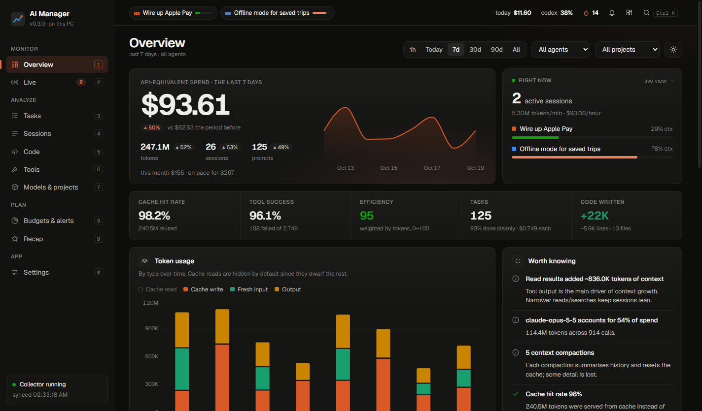
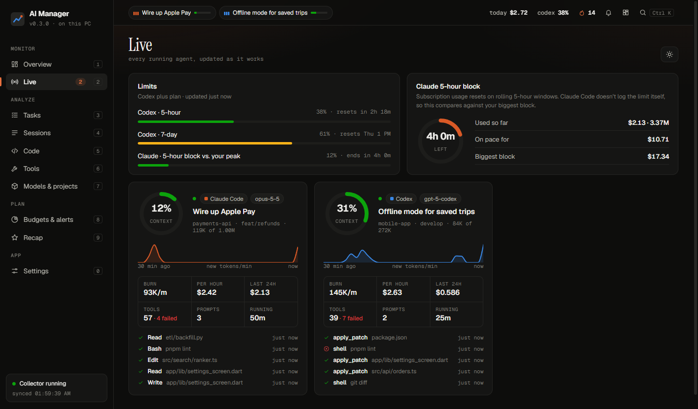
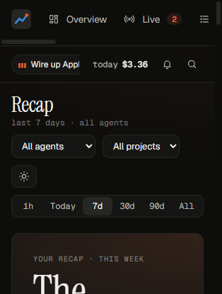
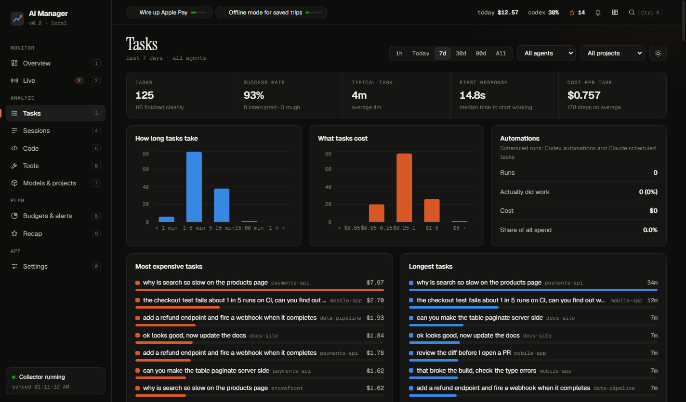
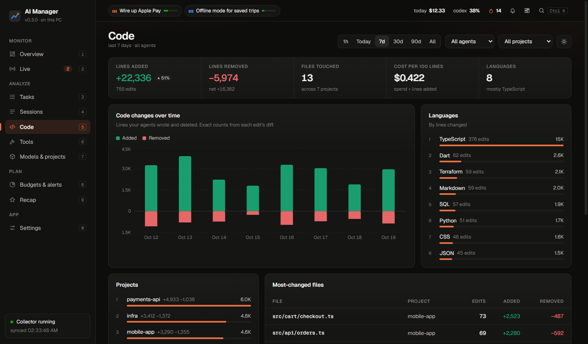
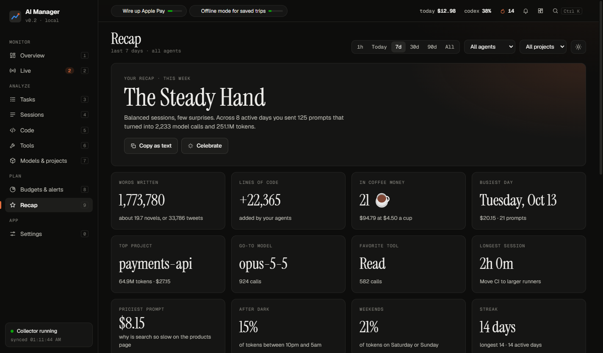

# AI Manager

A desktop app that shows what your coding agents are doing and what they cost. It tracks Claude Code and Codex live: tokens, spend, context, rate limits, tasks, lines of code, and which tools eat your context window. It also tells you when an agent has finished, so you can stop watching the terminal.

Everything runs on your computer. AI Manager reads the session logs Claude Code and Codex already save, so there's no account to connect and your data never leaves your machine.

**The source code is private.** This repo is the public page: what the app does, screenshots, and downloads.

## Download

Get the latest installer from [Releases](https://github.com/dadsadadsadad/ai-manager-showcase/releases).

- **Windows**: `AI.Manager.Setup.x.y.z.exe` installs it; `AI.Manager.x.y.z.exe` is a portable version that needs no install.
- Open it and it finds your Claude Code and Codex logs on its own. It keeps running in the tray when you close the window.

The installer isn't code-signed yet, so Windows SmartScreen may warn you the first time. Click **More info → Run anyway**.

## Why

Coding agents spend tokens in ways that are hard to see. One session can quietly fill most of a 1M-token context window, a flaky shell command can fail a hundred times in a row, and it's not obvious which project or model is behind your usage. AI Manager puts all of that in one place, live.

## What it does

**Watch your agents live**

- A bar across the top of every page shows running agents (with activity bars while they work), today's spend against your budget, Codex limits and your streak.
- A card per running session: context fill, tokens per minute, cost per hour, a 30-minute sparkline and its latest tool calls.
- A **pinned widget**: a small always-on-top panel with the numbers that matter. Toggle it with `Ctrl+Alt+A`.
- **Alerts** and desktop notifications when an agent finishes, its context window is nearly full, its tools keep failing, you reach a budget, or a Codex limit gets close.

  
  

**Understand where it goes**

- **Tasks**: every prompt as a task, with whether it finished, how long it took, how fast the agent started, how many steps it needed, lines changed and cost. Scheduled runs are counted separately.
- **Code**: lines added and removed per day, language, project and file. Counts come from the actual diffs, not estimates.
- **Sessions**: context growth on every call, what each step added, a tool timeline, files touched and the prompts you sent.
- **Tools**: call counts, failure rates and how much context each tool's output used, plus shell commands, MCP servers, skills and subagents.
- **Models and projects**: model mix over time, response lengths, how much output goes to thinking, cost per call and per project.
- **Budgets**: daily, weekly and monthly limits with an on-pace projection, and a year of daily spend.
- **Efficiency score**: 0–100 per session from cache reuse, tool failures, interrupts, context headroom and compactions, with the breakdown shown.

  
  

**And a little fun**

- **Recap**: a "wrapped"-style summary of a week, month or all time. You get an agent archetype, your busiest day, favorite model, words written (in novels), spend (in coffees) and a year of activity.
- **20 achievements**, from "Seven figures" to "Night owl" and "Epic task".
- **Make it yours**: eight themes plus a custom accent color, light and dark, glow, grid or dot backgrounds, serif or sans headings, compact mode and adjustable corners.
- A `Ctrl+K` command palette, and keyboard shortcuts for every page.

## Free and Pro

|                                                 | Free          | Pro                     |
| ----------------------------------------------- | ------------- | ----------------------- |
| Live view, pulse bar, widget, alerts            | ✓             | ✓                       |
| Overview, tasks, sessions, code, tools, models  | ✓             | ✓                       |
| Recap and achievements                          | ✓             | ✓                       |
| History                                         | last 30 days  | unlimited               |
| Keep history after Claude Code deletes old logs |               | ✓                       |
| Budgets, budget alerts, rate-limit alerts       |               | ✓                       |
| CSV and JSON export                             |               | ✓                       |
| Themes                                          | 3, light/dark | all, plus custom accent |

New installs get 14 days of Pro to try everything.

## How it works

- **Data**: Claude Code saves a transcript per session under `~/.claude/projects`, and Codex saves one under `~/.codex/sessions`. AI Manager reads each file from where it last stopped, so new activity shows up within a second or two.
- **Cost**: what the tokens would cost at API list prices. On a subscription you aren't billed per token, but it's the clearest way to compare how heavy different work was.
- **Claude limits**: Claude Code doesn't log its rate limit, so the app tracks your current 5-hour block against your biggest one. Codex logs its 5-hour and weekly windows, so those are exact.
- **Built with**: Node, React, Recharts and Electron, with a local HTTP + WebSocket server.
