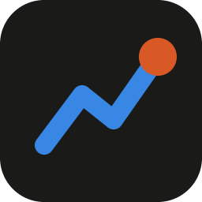

<h1 align="center">Trackage</h1>

  <a href="https://dadsadadsadad.github.io/trackage-showcase/">Website</a> ·
  <a href="PRIVACY.md">Privacy</a> ·
  <a href="SECURITY.md">Security</a> ·
  <a href="https://github.com/dadsadadsadad/trackage-cli">Collector source</a> ·
  <a href="https://github.com/dadsadadsadad/trackage-showcase/issues/new/choose">Feedback</a>

Usage, cost and context analytics for every AI coding agent you run: Claude Code, Codex, Gemini CLI, Qwen Code, OpenCode, Cline, Roo Code, Kilo Code, Aider, ChatGPT exports, and your own apps that call an AI API. Across every computer you work on, in one dashboard.

This repo is the public page: what Trackage does, how it treats your data, and where to send feedback. The collector that runs on your computer is open source at [trackage-cli](https://github.com/dadsadadsadad/trackage-cli); the website is a hosted service.

> Trackage is launching soon as a website. It replaces the AI Manager desktop app, which is discontinued; its old releases stay on this repo for existing users but get no updates.

## Why

Coding agents spend tokens in ways that are hard to see, and most people now use more than one. Trackage answers the questions single-tool trackers can't:

- **Is my subscription worth it?** The API-equivalent value of your usage against what Claude Max, ChatGPT Pro or Google AI Ultra costs you, plan by plan.
- **What would this have cost on another model?** Your exact token mix priced on 12 models from 6 vendors.
- **How do I compare?** Opt-in, anonymous benchmarks: efficiency, cache reuse, cost per prompt, tool failures.
- **What used up my limit?** Every call with its time and tokens, across all your machines.
- **What went wrong, and how do I spend less?** Every prompt is checked for cache rebuilds, failing tools, oversized results and models bigger than the job, with what each fix would have saved.
- **Does my invoice match?** Anthropic and OpenAI's daily charges next to what Trackage counted.
- **What is the team spending?** One view by person, project, agent and model, with a shared budget.

## What it does

- **Live**: every running agent on every linked computer, with context fill, burn rate and cost per hour.
- **Your dashboard**: drag, resize, add and remove cards; build several dashboards; themes, custom colors, glass or outline cards.
- **Charts your way**: Soft, Crisp, Blueprint or Minimal chart styles, and palettes including a colorblind-safe one.
- **Account security**: two-step sign-in, a list of signed-in browsers, and emails when anything security-related changes.
- **Alerts** in the app, on your phone, by email, or in Slack and Discord: agent finished, context nearly full, tool calls failing, a task over your target, budget or rate limit close.
- **Tasks, sessions, code, tools, models, projects**: where every token went, down to each model call, with what went wrong and how to do the same work for less.
- **Teams**: spend by person, project, agent and model, a shared monthly budget, and members who keep any project private.
- **Bill matching**: connect Anthropic or OpenAI (or upload their cost CSV) and see the bill and the counted cost side by side.
- **On your phone**: install it like an app and get alerts there, even with Trackage closed.
- **In your terminal**: `trackage report` shows today's spend, your budget and the biggest ways to spend less.
- **Budgets and forecasts**, a Monday email report, CSV/JSON export, and a usage API.
- **Recap** cards you can share.

## Plans

|                                   | Free             | Pro ($9/mo or $84/yr)          | Team ($15 or $144 per person)  |
| --------------------------------- | ---------------- | ------------------------------ | ------------------------------ |
| Every supported agent             | ✓                | ✓                              | ✓                              |
| Computers                         | 1                | 10                             | 10 per person                  |
| History                           | 14 days          | unlimited                      | unlimited                      |
| Live view, dashboard, sessions    | ✓                | ✓                              | ✓                              |
| Ways to spend less                | ✓                | ✓                              | ✓                              |
| Subscription value, model what-if | preview          | ✓                              | ✓                              |
| Tasks, code, budgets              |                  | ✓                              | ✓                              |
| Alerts                            | in the app       | + phone, email, Slack, Discord | + phone, email, Slack, Discord |
| Bill matching                     |                  | ✓                              | ✓                              |
| Benchmarks                        | efficiency score | every metric                   | every metric                   |
| Weekly report, export, usage API  |                  | ✓                              | ✓                              |
| Team view and shared budget       |                  |                                | ✓                              |

## How your data is handled

A small collector (`npx trackage`) reads the logs your agents already save and sends **numbers only**: token counts, timings, model and tool names, success or failure. Never prompts, session titles, replies, code, diffs, tool output or paths. `trackage sync --dry-run` prints every byte before anything is sent, and the [collector's source](https://github.com/dadsadadsadad/trackage-cli) is open for anyone to read. Details in [PRIVACY.md](PRIVACY.md).

## License

The collector is MIT-licensed ([trackage-cli](https://github.com/dadsadadsadad/trackage-cli)). The Trackage service is proprietary; the Free plan is free to use, and Pro and Team are subscriptions.
